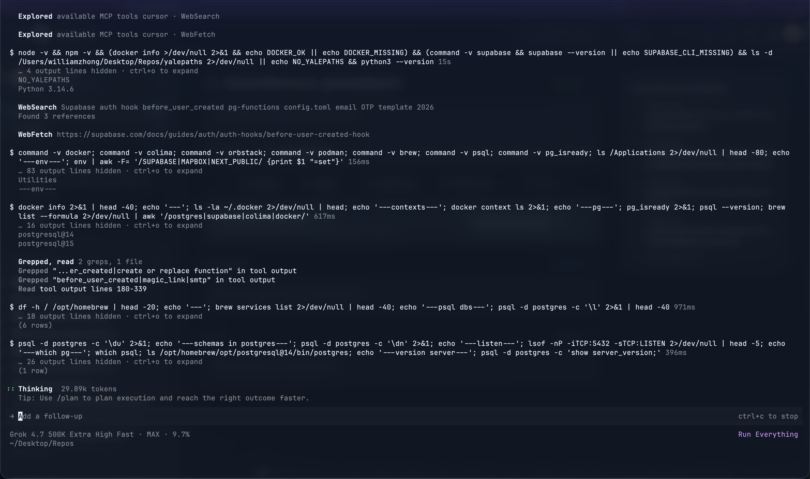

# YalePaths



A private atlas of where Yale members work, do research, and study. Experiences are self-reported. Sign-in is a one-time code to an exact `@yale.edu` address, separate from Yale SSO.

YalePaths is an independent student project and is not an official Yale University service.

## Requirements

- Node.js 20 or newer
- For the checked local stack: PostgreSQL 14 binaries (this machine uses Homebrew `postgresql@14`) and the Auth and PostgREST binaries in `.bin`
- For the Docker path: Docker and the [Supabase CLI](https://supabase.com/docs/guides/local-development)

## Local stack without Docker

This path runs Postgres, Supabase Auth (GoTrue), and PostgREST on localhost. It does not use the Postgres already listening on port 5432. Its cluster lives in `.pgdata` on port 54322.

```bash
npm install
npm run stack
```

In another terminal:

```bash
npm run seed
npm run dev
```

Open http://localhost:3000. `npm run stack` writes `.env.local` with the local URL and keys. Sign-in codes are saved under `.stack/mail` and are not sent to real inboxes. Stop the stack with `npm run stack:stop`.

The Auth binary is [supabase/auth v2.193.1](https://github.com/supabase/auth/releases/tag/v2.193.1) (`auth-v2.193.1-darwin-arm64.tar.gz`). PostgREST is [v16.6](https://github.com/PostgREST/postgrest/releases/tag/v16.6) (`postgrest-v16.6-macos-aarch64.tar.xz`). Put both executables in `.bin`. On this Mac, PostgREST expects `libpq` at `/opt/homebrew/opt/libpq/lib/libpq.5.dylib`; the stack links that path to the Homebrew Postgres 15 library when it is missing.

## Supabase CLI

`supabase/config.toml` enables email codes, the Yale-domain signup hook, and the magic-link template.

```bash
npx supabase start
npx supabase status
```

Copy the API URL and anon key into `.env.local` (see `.env.example`). The local JWT secret in `config.toml` is the public Supabase demo secret. Hosted projects must use the secret from the dashboard instead.

`npx supabase db reset` reapplies migrations. Demo people are loaded with `npm run seed`, which refuses any URL that is not localhost.

## Email codes

Passwordless sign-in uses a six-digit code. The template is `supabase/templates/magic_link.html` and includes `{{ .Token }}`. The same copy is used for the confirmation template so a first sign-in and a later sign-in both show the code. See [passwordless email](https://supabase.com/docs/guides/auth/auth-email-passwordless).

On a hosted project, paste that template into Authentication → Emails → Magic Link. The app asks for the code rather than the link, because the browser session uses PKCE.

The database hook `public.hook_restrict_to_yale_email` rejects signups whose address is not exactly `yale.edu`. Subdomains such as `cs.yale.edu` are not eligible. Row-level security checks the confirmed address again on every read and write, so a session for another domain cannot read records even if the hook is turned off.

## Pilot SMTP

Local Auth writes messages to `.stack/mail`. The CLI path shows them in Mailpit at http://127.0.0.1:54324. Neither delivers to a real Yale inbox.

Supabase's built-in mailer is only for project members and is rate-limited. Before a pilot, configure SMTP. See [custom SMTP](https://supabase.com/docs/guides/auth/auth-smtp). In `supabase/config.toml`:

```toml
[auth.email.smtp]
enabled = true
host = "smtp.resend.com"
port = 587
user = "resend"
pass = "env(SMTP_PASS)"
admin_email = "env(SMTP_ADMIN_EMAIL)"
sender_name = "YalePaths"
```

Set `SMTP_PASS` and `SMTP_ADMIN_EMAIL` in the host environment. On the hosted dashboard, use Authentication → SMTP and publish SPF and DKIM for the sending domain. Keep `enable_confirmations` on so a code is required.

## Map

Explore uses the free OpenStreetMap tile service. City pins come from the same shared experiences as the list. Selecting a pin narrows the list to that city. Zooming into a city splits that dot into one dot per organization, and OpenStreetMap’s search places the dot on the organization when it knows the address. Map data is © OpenStreetMap contributors.

## What members can do

- Continue with a Yale email, then set a display name. Class year is optional and self-reported. Alumni with a `yale.edu` inbox use the same flow.
- Explore shared experiences on the map and in an atlas index. Search matches city, organization, or lab. Filters cover type and year, starting at All years. A year matches when the record overlaps it. Ongoing records are treated as ending in the current month.
- Add an experience with a city from the picker. It starts private. Sharing keeps it searchable after it ends, until it is hidden or deleted.
- Open another member's profile only while that profile has a shared experience. LinkedIn, phone, and a contact email are shown only when the member opts in. The Yale sign-in address stays private.
- Message another member from their profile. Messages stay inside YalePaths and are visible only to the two people in the conversation.
- Delete an account from the profile page. That removes the login, profile, and experiences. Someone who has lost the inbox can write to `NEXT_PUBLIC_SUPPORT_EMAIL`, shown on the public page.

## Checks

```bash
npm test
npm run verify
npm run build
```

`npm run verify` needs the local stack and signs in two `@yale.edu` test accounts through the captured mailbox.

## Later

Not in this version: opt-in roommate matching, and verification for alumni who no longer have a Yale inbox.
